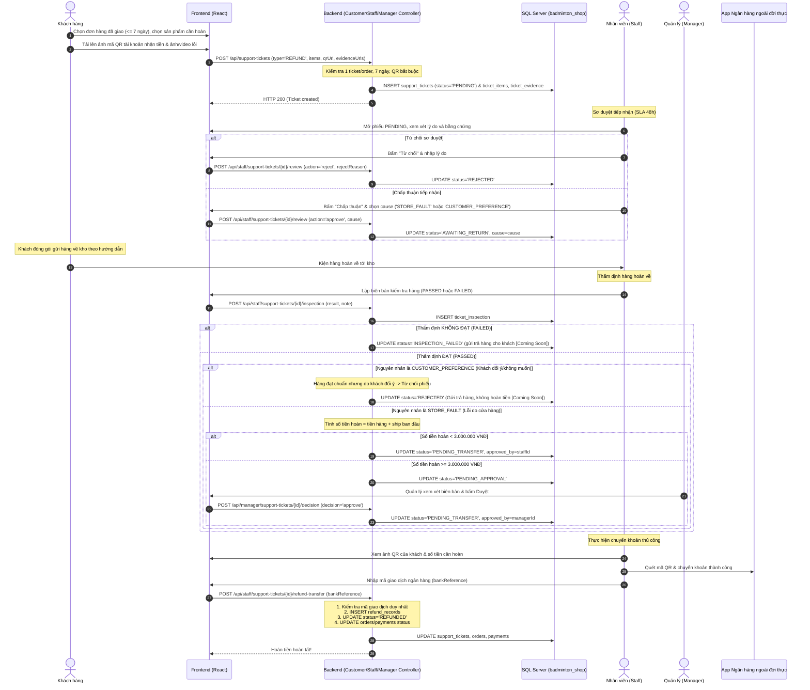
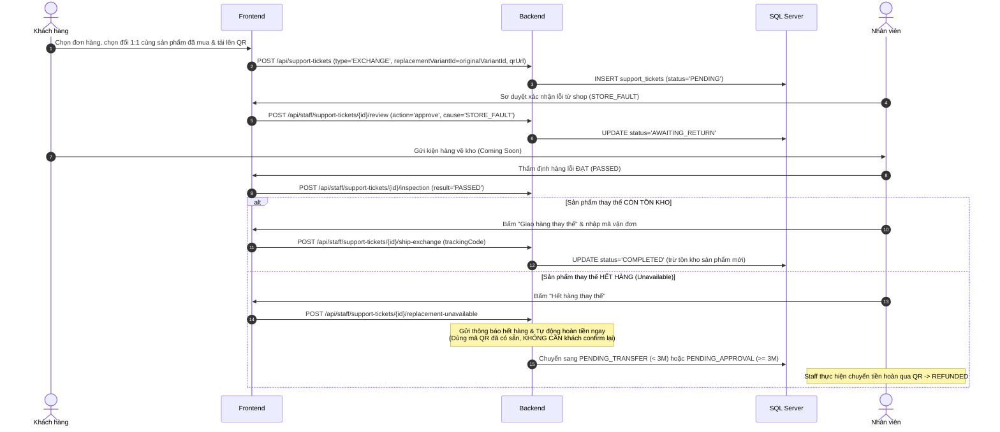

# LUỒNG HOẠT ĐỘNG MODULE ĐỔI TRẢ & HOÀN TIỀN (UC15: EXCHANGES & REFUNDS)
> **Dự án:** SBA301_BadmintonShop_SE1986-JV  
> **Phân hệ:** Support Ticket / Exchanges & Refunds (UC15)  
> **Kiến trúc:** Java 21, Spring Boot, Spring Data JPA, SQL Server, React Vite Frontend

---

## 1. TỔNG QUAN NGHIỆP VỤ & QUY TẮC CỐT LÕI

Phân hệ Đổi trả & Hoàn tiền (UC15) xử lý khiếu nại sau bán hàng cho các đơn hàng trực tuyến đã giao thành công, tuân thủ các nguyên tắc thiết kế sau:

1. **Loại bỏ COD & Ví điện tử:** Tất cả các đơn hàng hoàn tiền đều là các giao dịch đã thanh toán trực tuyến qua Cổng thanh toán (payOS).
2. **Hoàn tiền chuyển khoản thủ công qua mã QR ngân hàng (100% Manual):**
   * Khách hàng **bắt buộc tải lên ảnh mã QR tài khoản ngân hàng** nhận tiền khi tạo ticket (áp dụng cho cả `REFUND` và `EXCHANGE`).
   * Không lưu thông tin số tài khoản / tên ngân hàng dạng text (loại bỏ lỗi chính tả của khách).
   * Nhân viên quét ảnh QR của khách bằng ứng dụng Mobile Banking ngoài đời thực, thực hiện chuyển tiền, sau đó **nhập Mã tham chiếu giao dịch ngân hàng (`bank_reference`)** vào hệ thống để đối soát.
3. **Đổi hàng 1:1 cùng chính xác sản phẩm đã mua (Không đổi sang sản phẩm khác):**
   * Chỉ áp dụng chính sách **1 đổi 1 cho chính sản phẩm/biến thể đã mua** bị lỗi do cửa hàng (đổi lấy sản phẩm mới nguyên vẹn cùng loại), **không hỗ trợ đổi sang sản phẩm hoặc biến thể khác cùng giá tiền**.
   * Hệ thống không thu thêm phụ phí chênh lệch giá hoặc phí vận chuyển đổi hàng.
   * **Tự động chuyển hoàn tiền khi hết hàng thay thế:** Nếu kiểm tra kho thấy sản phẩm thay thế đã hết hàng, hệ thống sẽ **gửi thông báo hết hàng và tự động chuyển sang luồng hoàn tiền cho khách (dùng mã QR đã upload ban đầu, không cần khách phải xác nhận lại)**.
4. **Chính sách đổi trả chỉ áp dụng khi lỗi từ phía cửa hàng (`STORE_FAULT`):**
   * Cửa hàng **chỉ chấp nhận đổi hàng hoặc hoàn tiền khi lỗi phát sinh từ phía shop / nhà sản xuất** (`STORE_FAULT`: giao sai mẫu, sai kích cỡ, sản phẩm lỗi nứt/bong tróc, hư hại khi mở hộp, thiếu phụ kiện...). Cửa hàng **hoàn lại cả tiền phí vận chuyển ban đầu**.
   * Trường hợp hàng hoàn về kiểm tra đạt chuẩn (hàng không lỗi) nhưng nguyên nhân xuất phát từ **nhu cầu cá nhân / khách hàng đổi ý không muốn nhận (`CUSTOMER_PREFERENCE`)** $\rightarrow$ Hệ thống sẽ **Từ chối phiếu (`REJECTED`)**, gửi trả lại sản phẩm ban đầu cho khách và **không hoàn tiền**.
   * **Quy tắc không cộng lại kho (`No Restock`):** Do cửa hàng chỉ tiếp nhận hàng lỗi do shop để tiến hành bảo hành/thu hồi/hoàn tiền, các sản phẩm lỗi này không được đưa trở lại bán đại trà, do đó hệ thống **không thực hiện tự động cộng lại tồn kho**.
5. **Hạn mức phê duyệt 3.000.000 VNĐ:**
   * Số tiền hoàn **dưới 3.000.000 VNĐ**: Nhân viên (Staff) có thẩm quyền phê duyệt trực tiếp sang trạng thái chờ chuyển tiền (`PENDING_TRANSFER`).
   * Số tiền hoàn **từ 3.000.000 VNĐ trở lên**: Bắt buộc chuyển sang trạng thái chờ Quản lý phê duyệt (`PENDING_APPROVAL`). Chỉ tài khoản có vai trò `MANAGER` mới được phép duyệt hoặc từ chối.
6. **Ràng buộc duy nhất:** Mỗi đơn hàng chỉ được tạo tối đa 1 phiếu hỗ trợ (`UNIQUE order_id`).
7. **Vận chuyển chiều ngược lại (Reverse Logistics) — [Coming Soon / Chưa phát triển]:**
   * Việc tích hợp API đơn vị vận chuyển tự động cho chiều ngược lại (khách gửi hàng hoàn về kho hoặc shop gửi trả hàng bị từ chối về lại cho khách) hiện tại được đánh dấu là **`Coming Soon (Chưa phát triển)`**.
   * Toàn bộ quy trình gửi hàng ngược chiều hiện xử lý thủ công ngoài đời thực (khách tự gửi bưu phẩm theo địa chỉ kho hướng dẫn; nhân viên nhận hàng và thẩm định trực tiếp).

---

## 2. SƠ ĐỒ TUẦN TỰ HOẠT ĐỘNG (SEQUENCE DIAGRAMS)

### 2.1. Luồng Trả hàng & Hoàn tiền (Refund Flow)



---

### 2.2. Luồng Đổi sản phẩm (Exchange Flow - Đổi 1:1 cùng sản phẩm đã mua)



---

## 3. MA TRẬN 9 TRẠNG THÁI VÒNG ĐỜI (STATE TRANSITIONS)

| Trạng thái | Tên tiếng Việt | Quyền hạn thao tác | Ý nghĩa & Điều kiện chuyển tiếp |
| :--- | :--- | :--- | :--- |
| `PENDING` | Chờ tiếp nhận sơ duyệt | Khách hàng, Staff | Phiếu vừa tạo. Khách có thể bấm **Hủy (`CANCELLED`)**. Staff duyệt (chọn `cause` $\rightarrow$ `AWAITING_RETURN`) hoặc từ chối (`REJECTED`). |
| `REJECTED` | Bị từ chối | - | Trạng thái kết thúc. Bị Staff từ chối ở bước sơ duyệt, hoặc bị từ chối sau thẩm định vì hàng đạt chuẩn nhưng nguyên nhân là do khách đổi ý (`CUSTOMER_PREFERENCE`), hoặc Quản lý từ chối duyệt hoàn tiền. |
| `AWAITING_RETURN` | Chờ gửi lại hàng | Khách hàng, Staff | Khách đóng gói gửi hàng về địa chỉ kho. Staff nhận hàng và ghi nhận biên bản kiểm tra. |
| `INSPECTION_FAILED`| Kiểm tra không đạt | - | Trạng thái kết thúc. Hàng hoàn về không đủ điều kiện (bị can thiệp, hư hại do người dùng), hàng gửi trả lại khách, chặn hoàn tiền. |
| `PENDING_APPROVAL` | Chờ Quản lý duyệt | Quản lý (Manager) | Áp dụng khi số tiền hoàn $\ge 3.000.000$ VNĐ sau khi kiểm tra đạt. Chỉ Quản lý mới có quyền duyệt hoặc từ chối. |
| `PENDING_TRANSFER` | Chờ chuyển tiền | Nhân viên (Staff) | Khoản hoàn đã được duyệt (Staff duyệt nếu $< 3$ triệu, Quản lý duyệt nếu $\ge 3$ triệu). Nhân viên quét QR để chuyển tiền. |
| `REFUNDED` | Đã hoàn tiền | - | Trạng thái kết thúc. Nhân viên nhập mã tham chiếu ngân hàng thành công. Ghi nhận `refund_records`. |
| `COMPLETED` | Đã hoàn tất đổi hàng | - | Trạng thái kết thúc. Hàng thay thế còn tồn kho và đã được xuất kho giao cho khách. |
| `CANCELLED` | Đã hủy | - | Trạng thái kết thúc. Khách chủ động hủy khi còn `PENDING` hoặc hết hàng thay thế do `CUSTOMER_PREFERENCE`. |

---

## 4. BẢNG DANH MỤC API SPECIFICATIONS

| Method | Endpoint | Quyền truy cập | Mục đích |
| :--- | :--- | :--- | :--- |
| `POST` | `/api/support-tickets` | Khách hàng | Tạo yêu cầu đổi hàng / hoàn tiền kèm ảnh QR và bằng chứng |
| `GET` | `/api/support-tickets` | Khách hàng | Danh sách phiếu hỗ trợ của khách hàng đang đăng nhập |
| `GET` | `/api/support-tickets/{id}` | Khách hàng / Staff | Xem chi tiết tiến trình phiếu hỗ trợ |
| `POST` | `/api/support-tickets/{id}/cancel` | Khách hàng | Khách hủy yêu cầu (chỉ khi còn `PENDING`) |
| `GET` | `/api/staff/support-tickets` | Staff / Manager | Hàng đợi danh sách ticket (lọc theo status/type) |
| `POST` | `/api/staff/support-tickets/{id}/review` | Staff | Sơ duyệt tiếp nhận: chọn `cause` hoặc từ chối |
| `POST` | `/api/staff/support-tickets/{id}/inspection` | Staff | Ghi nhận biên bản kiểm định hàng (`PASSED` / `FAILED`) |
| `POST` | `/api/staff/support-tickets/{id}/approve-refund`| Staff | Duyệt hoàn tiền cho đơn dưới 3.000.000 VNĐ |
| `POST` | `/api/staff/support-tickets/{id}/ship-exchange` | Staff | Xác nhận gửi hàng thay thế khi kho còn hàng |
| `POST` | `/api/staff/support-tickets/{id}/replacement-unavailable` | Staff | Báo hết hàng thay thế (tự động rẽ nhánh theo `cause`) |
| `POST` | `/api/staff/support-tickets/{id}/refund-transfer` | Staff | Nhập `bankReference` xác nhận đã chuyển khoản manual |
| `POST` | `/api/manager/support-tickets/{id}/decision` | Manager | Quản lý phê duyệt / từ chối khoản hoàn $\ge 3.000.000$ VNĐ |

---

## 5. LỆNH TEST MOCK (CURL EXAMPLES)

### 5.1. Khách hàng tạo phiếu hoàn tiền (`REFUND`)
```bash
curl -X POST http://localhost:8080/api/support-tickets \
  -H "Content-Type: application/json" \
  -H "X-User-Id: 10" \
  -d '{
    "orderId": 1,
    "ticketType": "REFUND",
    "reason": "Vợt có dấu hiệu nứt ở khớp nối chữ T",
    "description": "Mở hộp kiểm tra phát hiện vết nứt dài 2cm",
    "refundQrUrl": "https://img.vietqr.io/image/970422-0901234567-compact2.jpg",
    "evidenceUrls": ["https://res.cloudinary.com/demo/image/upload/sample_defect.jpg"],
    "items": [
      {
        "orderItemId": 101,
        "quantity": 1
      }
    ]
  }'
```

### 5.2. Nhân viên chấp thuận sơ duyệt kèm nguyên nhân (`STORE_FAULT`)
```bash
curl -X POST http://localhost:8080/api/staff/support-tickets/1/review \
  -H "Content-Type: application/json" \
  -H "X-User-Id: 2" \
  -d '{
    "action": "approve",
    "cause": "STORE_FAULT",
    "note": "Xác nhận lỗi từ phía nhà sản xuất"
  }'
```

### 5.3. Nhân viên lưu kết quả kiểm tra hàng đạt (`PASSED`)
```bash
curl -X POST http://localhost:8080/api/staff/support-tickets/1/inspection \
  -H "Content-Type: application/json" \
  -H "X-User-Id: 2" \
  -d '{
    "result": "PASSED",
    "note": "Hàng trả về còn nguyên tem bảo hành, phụ kiện đầy đủ"
  }'
```

### 5.4. Nhân viên xác nhận chuyển tiền hoàn và lưu mã giao dịch
```bash
curl -X POST http://localhost:8080/api/staff/support-tickets/1/refund-transfer \
  -H "Content-Type: application/json" \
  -H "X-User-Id: 2" \
  -d '{
    "bankReference": "FT26103188991234",
    "note": "Đã chuyển khoản qua app Vietcombank"
  }'
```

